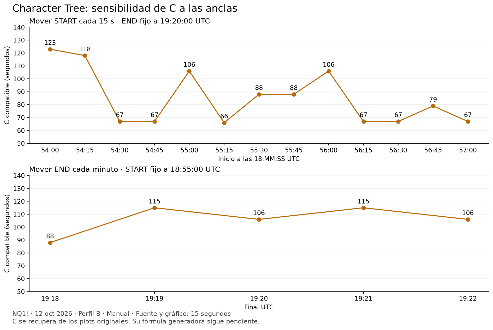

# Sensibilidad de Character C a las anclas

12 de octubre de 2026. NQ1!, Character Tree v6.5.36, perfil B, Manual, dirección Auto. Fuente interna y gráfico de 15 segundos.

## Resultado

Se completó el barrido de START cada 15 segundos y un control adicional moviendo END cada minuto. **Todavía no se identificó la fórmula generadora de C.** Los números de este informe se extraen de las diez curvas originales por su recurrencia EMA y la familia 72/89.



Las líneas de la figura conectan muestras. No representan una interpolación ni una predicción entre ellas.

## START variable, END fijo

END=19:20:00 UTC. Los trece casos comparten máximo 30,868.75, mínimo 30,846.00 y la vela final de 15 segundos.

| START UTC | Único C entero compatible |
| --- | ---: |
| 18:54:00 | 123 s |
| 18:54:15 | 118 s |
| 18:54:30 | 67 s |
| 18:54:45 | 67 s |
| 18:55:00 | 106 s |
| 18:55:15 | 66 s |
| 18:55:30 | 88 s |
| 18:55:45 | 88 s |
| 18:56:00 | 106 s |
| 18:56:15 | 67 s |
| 18:56:30 | 67 s |
| 18:56:45 | 79 s |
| 18:57:00 | 67 s |

La referencia 18:55 se midió antes del barrido y durante él: conserva los mismos diez períodos. Después de recorrer hasta 18:57, se volvió a 18:54:30: mantiene los diez períodos y C compatible con 67 segundos. Cada caso del barrido tiene 395 pares consecutivos por curva y errores de recurrencia menores de 2×10⁻¹² puntos.

Los cambios 118→67 y 106→66 aparecen al retirar una sola vela de 15 segundos, sin cambiar los extremos ni END. Hay pares consecutivos que conservan exactamente los períodos. La selección por eventos o una regla con ramas son hipótesis, no hallazgos de implementación. Un algoritmo continuo con una condición mal condicionada también podría dar saltos grandes al cambiar muestras.

## END variable, START fijo

START=18:55:00 UTC, misma resolución de 15 segundos.

| END UTC | Único C entero compatible |
| --- | ---: |
| 19:18:00 | 88 s |
| 19:19:00 | 115 s |
| 19:20:00 | 106 s |
| 19:21:00 | 115 s |
| 19:22:00 | 106 s |

Este control agrega velas y modifica el OHLC final. La repetición de C entre finales distintos no demuestra que el indicador use el mismo evento interno.

## Diferencia frente a la prueba de un minuto

START=18:55, END=19:20 dio C≈62 s con fuente/gráfico de un minuto y C≈106 s con fuente/gráfico de 15 segundos. **No se interpreta como un cambio puro de resolución:** END=19:20 selecciona toda la vela 19:20–19:20:59 en el primer caso, pero solo 19:20:00–19:20:14 en el segundo. Cambian la agregación, el OHLC final y la cobertura temporal. Los barridos anteriores sí mantienen una fuente fija dentro de cada grupo.

Se hizo un control adicional, moviendo END fino a **19:20:45**, para incluir la última vela de 15 segundos del minuto. C pasa a ser compatible con **66 s**, intervalo [65.98314606741573, 66.00694444444444). Comparte la cobertura temporal hasta 19:20:59 con la referencia de un minuto de C≈62 s, aunque sigue cambiando la agregación y el OHLC de la vela END: los cuatro cuartos de minuto no son una sola vela. La diferencia residual de cuatro segundos no se atribuye a redondeo: ambos intervalos inferidos son disjuntos. Este control respalda investigar cómo se usa la vela final y evita atribuir el salto 62→106 únicamente a la granularidad.

Se reconstruyeron las **26 velas de un minuto** desde las 104 velas de 15 segundos del control de cobertura. Sus OHLC coinciden exactamente con las velas de la exportación original de un minuto. También se verificó que las velas comunes 18:57:00–19:20:00 son idénticas en los trece archivos del barrido de START.

## Procedimiento y datos

El campo de hora de los inputs recorta los segundos. Para los inicios subminuto se arrastró Point 1 directamente sobre las velas y se verificó el timestamp HH:MM:SS que aparece en el gráfico. Se mantuvo END fijo. Los campos de precio se usan para colocar los controles en pantalla; las pruebas anteriores no mostraron efecto del precio de Point 1 en C y el tooltip declara que el precio de END se ignora en Manual.

Se observaron los recálculos antes de exportar y se comprobaron referencias mediante repeticiones. Las exportaciones `C_15s_start*.csv` conservan el OHLC y las curvas originales. El registro completo, con intervalos de C, períodos y errores, está en `C_sensibilidad_15s.json`; `analizar_C_15s.py` lo reproduce.

El único entero compatible no prueba que el cálculo interno sea entero: se conserva siempre el intervalo derivado del redondeo de los períodos.

## Qué deben explicar las próximas hipótesis

Una candidata debe reproducir estos saltos y mesetas, respetar la cobertura temporal y acertar fuera de este barrido. No basta ajustar una constante al caso de 18:55. Sigue pendiente explicar qué datos del recorrido selecciona el cálculo y cómo los transforma en C.

El layout se guardó mostrando el control START=18:55:00, END=19:20:45 UTC, fuente y gráfico de 15 segundos, C≈66 s. La captura `C_15s_control_cobertura.jpg` permite revisar las dos anclas.

## Continuación: límites temporales y mecha final

Se completaron los dos cuartos de minuto intermedios de END, manteniendo START=18:55:00 y fuente/gráfico de 15 segundos.

| END UTC | C entero compatible | High del rango | Low del rango | Low de END | Close de END |
| --- | ---: | ---: | ---: | ---: | ---: |
| 19:20:00 | 106 s | 30,868.75 | 30,846.00 | 30,866.00 | 30,866.50 |
| 19:20:15 | 79 s | 30,868.75 | 30,846.00 | 30,864.50 | 30,866.00 |
| 19:20:30 | 67 s | 30,868.75 | 30,846.00 | 30,866.00 | 30,868.25 |
| 19:20:45 | 66 s | 30,870.50 | 30,846.00 | 30,868.00 | 30,870.50 |

Los casos 19:20:00 y 19:20:30 mantienen los extremos del rango y el low de END, pero cambian C. **C no es una función exclusivamente de esas tres referencias de precio.** El control no separa el cierre del resto del recorrido añadido ni descarta algoritmos que empleen la mecha junto con otros datos.

### Anclas subminuto con fuente de un minuto

Se conservaron timestamps subminuto elegidos en el gráfico de 15 segundos y se cambió la fuente a «1 minute». Para extraer C se usó también gráfico de un minuto, evitando ajustar una EMA de un minuto contra cierres de 15 segundos. Después se volvió al gráfico fino para verificar que el timestamp de la ancla seguía siendo el solicitado.

| START solicitado UTC | END solicitado UTC | Fuente | C entero compatible |
| --- | --- | --- | ---: |
| 18:54:00 | 19:20:00 | 1 minuto | 134 s |
| 18:54:15 | 19:20:00 | 1 minuto | 62 s |
| 18:54:30 | 19:20:00 | 1 minuto | 62 s |
| 18:55:00 | 19:20:00 | 1 minuto / referencia Chart | 62 s |
| 18:55:00 | 19:20:30 | 1 minuto | 62 s |

Los diez períodos de los cuatro casos de C≈62 coinciden exactamente. Las nuevas extracciones tienen al menos 92 pares consecutivos por curva y error de recurrencia menor de 2×10⁻¹² puntos.

**Interpretación empírica:** los controles son consistentes con seleccionar velas fuente cuya hora de apertura cumpla `START <= time <= END`. Con fuente de un minuto, START=18:54:15 o 18:54:30 deja fuera la vela que abrió a las 18:54 y comienza con la de las 18:55. END=19:20:30 sigue terminando en la vela que abrió a las 19:20. El indicador dibuja la caja hasta las anclas solicitadas, por lo que su borde gráfico no debe confundirse con la primera apertura fuente incluida. No se leyó el código original y esta regla no se ha comprobado en todos los modos ni en huecos de sesión.

La captura `C_ancla_subminuto_fuente1m.jpg` muestra START=18:54:30 sobre gráfico fino con fuente de un minuto; `C_END_subminuto_fuente1m.jpg` muestra END=19:20:30. Un primer intento de mover END solo desplazó el gráfico: `C_1m_end_subminuto_comprobacion.csv` mantiene END=19:20:00 y **no se usa como prueba subminuto**. El control válido es `C_1m_start185500_end192030.csv`, tomado tras verificar la etiqueta 19:20:30.

El registro reproducible está en `C_limites_y_mecha.json` y `analizar_C_limites.py`. Sus comprobaciones comparan los períodos y las referencias de precio de estos controles.

### Otra clase de cálculo descartada provisionalmente

Se contrastó C como la escala que hace cruzarse dos EMAs en un extremo del rango: `N_fast=K*C/Δ`, `N_slow=r*N_fast`, con relaciones r=89/72 y r=84/78. Se probaron recorridos cronológicos e inversos, cuatro inclusiones de los bordes, cuatro fuentes de precio y semillas OHLC/extremos/punto medio para las dos EMAs.

La búsqueda cubre 3,136 variantes en 25 rangos distintos, con longitudes entre 1 y 10,000. No encontró una constante K común que explicase C con la precisión observada. El mejor candidato recuperado requiere constantes por caso entre aproximadamente 4.09 y 9.28, incompatibles con una única K. Son resultados de una búsqueda numérica con raíces interpoladas y selección de ramas, no una demostración que descarte todo filtro doble o todo algoritmo de ajuste. No cubre ventanas dinámicas, criterios de contacto en velas interiores ni otras semillas.

La búsqueda se reproduce con `probar_C_cruce_doble.py`; el resultado queda en `C_cruce_doble.json`. **La fórmula generadora de C sigue pendiente.** Se conoce mejor cómo delimitar las velas fuente, pero no cómo transformarlas en C.

Al terminar esta continuación se restauró START=18:55:00, END=19:20:00 UTC, gráfico de un minuto y fuente Chart, C≈62 s.

## Continuación: resolución de presentación y perfiles

Se mantuvieron las anclas 18:55:00–19:20:00 UTC y se fijó explícitamente la fuente a «1 minute». Se cambió únicamente el gráfico de un minuto a 15 segundos. La exportación `C_fuente1m_grafico15s.csv` reproduce exactamente las diez curvas de la referencia de un minuto, al alinear los timestamps:

| Tramo de la vela del gráfico | Valor coincidente de la fuente de un minuto | Valores comparados | Error máximo |
| --- | --- | ---: | ---: |
| :00, :15 y :30 | Vela del minuto anterior | 930 por fase | 0 |
| :45 | Vela del minuto actual | 940 | 0 |

Se excluyeron los dos minutos finales comunes para evitar comparar velas aún en curso exportadas en instantes diferentes. El ajuste sin esta exclusión mostraba diferencias en el extremo reciente; no se ocultaron mediante tolerancias. La igualdad de los valores históricos es exacta en los decimales exportados.

**Resultado:** en este control, la resolución del gráfico no modifica C ni los períodos si la fuente interna permanece fija. La distribución por fases es consistente con publicar la EMA de la vela fuente en el último tramo histórico de 15 segundos de ese minuto. No demuestra por sí sola el comportamiento intravela en directo ni la ausencia de repintado de las señales.

Después se probaron los perfiles A, C y D con gráfico y fuente de un minuto, comparándolos con la referencia B. Cada perfil conserva los diez períodos `25/31, 8/10, 3/3, 74/92, 223/276`, el intervalo de C `[61.91011235955056, 62.083333333333336)` y el único entero compatible 62. En cada perfil, 940 valores históricos coinciden exactamente con B. El error de la recurrencia EMA es menor de 2×10⁻¹² puntos.

Esto descarta el perfil como explicación de diferencias de C **para este rango y estas opciones**. No se compararon exhaustivamente las etiquetas de señales, otros modos de selección ni todos los rangos. Los colores cambian visualmente entre perfiles; los plots medidos no cambiaron.

Reproducción: `comparar_resolucion_C.py` genera `C_control_resolucion.json`; `analizar_C_perfiles.py` genera `C_control_perfiles.json`. Los CSV de cada perfil se guardan como `C_perfil_A_fuente1m.csv`, `C_perfil_C_fuente1m.csv` y `C_perfil_D_fuente1m.csv`.

Se restauraron perfil B, fuente Chart, gráfico de un minuto y anclas 18:55:00–19:20:00. La nueva exportación `C_referencia_restaurada_perfiles.csv` verifica C≈62. Captura final: `C_resolucion_perfiles_final.jpg`.

**Pendiente:** obtener C exclusivamente a partir de OHLC. Estos controles eliminan dos factores de presentación y permiten diseñar las siguientes pruebas sobre las velas fuente. No se ha obtenido una fórmula generadora nueva en esta continuación.

## Continuación: orden de anclas, dirección y contactos interiores

### Orden de anclas y dirección de Flow Bands

Se invirtieron únicamente las horas de Point 1 y Point 2: Point 1=19:20, Point 2=18:55, en el mismo día. La caja y las curvas desaparecen, y `C_anclas_invertidas_25m.csv` contiene cero valores de las diez curvas. La captura `C_anclas_invertidas.jpg` registra el resultado. **No se interpreta como C=0 ni como cálculo inverso:** este control muestra que el indicador no normaliza automáticamente ese par de anclas invertidas en modo Manual. No se comprobó una restricción global en todos los modos.

Después se restauró START=18:55, END=19:20 y se cambió «Direction mode» de Flow Bands de Auto a Bull y Bear. Esta opción es distinta de «Setup direction», que según su descripción aplica al modo Auto Balanced. Tanto Bull como Bear conservan C en `[61.91011235955056, 62.083333333333336)` y los diez períodos de la referencia. En cada exportación coinciden exactamente 1,040 valores de curvas con Auto. Por tanto, en este caso no modifican C ni la semilla efectiva de las curvas visibles.

Las etiquetas visibles de Flow Bands sí cambian al forzar Bear (`C_flow_Bear_control.jpg`). Las columnas exportadas `Bull delivery active` y `Bear delivery active` no cambian en los 432 timestamps comparados; no se deben usar como equivalentes de todas las etiquetas de Flow Bands. No se auditó la secuencia completa de señales.

Archivos: `C_flow_Bull_25m.csv`, `C_flow_Bear_25m.csv`, `analizar_C_orden_direccion.py` y `C_orden_direccion.json`.

### C como contacto de una EMA con una vela interior

Se amplió la búsqueda a un criterio que no estaba cubierto por los ajustes anteriores de la vela final: una EMA cuya longitud `N=K*C/Δ` produce un contacto con un precio de una vela interior del rango.

Se probaron 10,752 variantes: recorrido cronológico o inverso; fuentes close/hl2/hlc3/ohlc4; cuatro inclusiones de extremos; siete semillas OHLC/extremos/punto medio; valor antes o después de actualizar la EMA; contacto con open/high/low/close; selección de la menor/mayor longitud de todos los contactos, o del primero/último en orden de procesamiento. Los extremos de cada secuencia procesada se excluyen como objetivos de contacto. El conjunto contiene 25 rangos distintos, sin los casos limitados por el mínimo empírico C=Δ.

Se buscaron raíces por cambios de signo entre N=1.00001 y 10,000 con 1,200 puntos logarítmicos. 10,008 modelos tienen contactos en todos los casos, pero ninguna selección ensayada produjo una constante K común. El mejor candidato usa recorrido cronológico, hlc3, todas las velas, semilla en el máximo del rango, valor EMA previo a la actualización y primer contacto con un low, seleccionando la raíz menor. Requiere K entre aproximadamente **0.426 y 1.799**, una variación de más de cuatro veces.

Se refinaron los cinco mejores candidatos con mallas de 4,800 y 19,200 puntos. En el mejor, el mayor cambio relativo respecto a la malla original es de aproximadamente **0.0013%**; la dispersión no se explica por esa resolución numérica.

El resultado descarta provisionalmente **las variantes y selecciones enumeradas**, no todo posible algoritmo de contacto. No cubre semillas dependientes de una ventana variable, otros filtros, criterios múltiples de ajuste ni raíces tangentes sin cambio de signo. La búsqueda usa el entero compatible de C como referencia; las diferencias de K del mejor candidato superan ampliamente el pequeño intervalo de C inferido por redondeo.

Reproducción: `probar_C_contacto_interior.py` genera `C_contacto_interior.json`; `refinar_C_contacto.py` genera `C_contacto_convergencia.json`. Se restauraron las anclas normales, perfil B, fuente Chart, gráfico de un minuto y Flow Bands Auto. `C_referencia_restaurada_direccion.csv` verifica nuevamente C≈62; captura final `C_orden_direccion_final.jpg`.

**Estado:** la familia de EMAs está reproducida una vez dado C. El origen de C exclusivamente desde las velas sigue sin resolverse.

## Continuación: agregación fuente con cobertura idéntica

Se midieron dos tramos usando fuentes y gráficos nativos de 30 segundos, un minuto y dos minutos. Se conservaron perfil B, modo Manual y Flow Bands Auto. END se colocó y verificó en el gráfico fino a las **19:21:30 UTC**, antes de cambiar la resolución. El último período fuente incluido abre a las 19:21:30, 19:21:00 y 19:20:00, respectivamente; los tres terminan cubriendo hasta las 19:21:59.

| START UTC | Cobertura fuente completa | Velas 30s / 1m / 2m | C compatible 30s | C compatible 1m | C compatible 2m |
| --- | --- | --- | ---: | ---: | ---: |
| 18:54:00 | [18:54:00, 19:22:00), 28 minutos | 56 / 28 / 14 | ≈136 s | ≈109 s | ≈120 s |
| 18:00:00 | [18:00:00, 19:22:00), 82 minutos | 164 / 82 / 41 | ≈196 s | ≈196 s | ≈268 s |

Los controles verifican **cada timestamp y cada OHLC**: agregar las velas de 30 segundos reproduce exactamente las velas exportadas de un minuto y dos minutos. En cada tramo también coinciden los extremos globales y el cierre final. La duración solicitada entre anclas es 27m30s o 81m30s; la cobertura completa de las velas fuente es 28m o 82m. No se confunden ambas duraciones.

Las diez curvas siguen la familia de períodos ya medida, con al menos 54 pares consecutivos por curva y error de recurrencia inferior a 2×10⁻¹² puntos. Intervalos de C por redondeo:

| START | Fuente | Intervalo C, segundos |
| --- | --- | --- |
| 18:54 | 30s | [135.902778, 136.011236) |
| 18:54 | 1m | [108.876404, 109.027778) |
| 18:54 | 2m | [119.775281, 120.224719) |
| 18:00 | 30s | [195.902778, 196.011236) |
| 18:00 | 1m | [195.972222, 196.067416) |
| 18:00 | 2m | [267.640449, 268.055556) |

El caso corto de dos minutos es compatible con el mínimo empírico observado C=Δ. Por ese motivo se añadió el tramo largo: su C≈268 está por encima de Δ=120 y difiere de C≈196 de las fuentes más finas. Los intervalos de 30s y 1m del tramo largo se solapan; el único entero compatible es 196 en ambos, sin demostrar que sus C internos no enteros sean idénticos.

**Conclusiones limitadas a estos controles:** C no se conserva universalmente al agregar las velas de la misma cobertura, ni es simplemente proporcional a Δ. Una función exclusivamente de la duración completa, el máximo, el mínimo y el cierre final tampoco explica las diferencias entre fuentes. Aún pueden influir los OHLC iniciales/finales, el recorrido de las velas agregadas, las referencias de tiempo o una regla de ajuste que depende de la resolución. No se atribuye la diferencia a una de esas variables en particular.

La primera exportación de 30s del tramo largo incluía solo 46 de las 164 velas requeridas. Se conserva como `C_agregacion_1800_192130_30s_incompleto.csv` y se **excluye de la comparación**. Después se visitó el comienzo del rango y se reexportó con las 164 velas, verificando además START=18:00 en los ajustes. La extracción de C fue compatible con 196 en ambos archivos, pero solo el segundo permite validar la cobertura y agregación. Esta observación no demuestra por sí sola cómo el indicador gestiona datos ausentes.

Los seis CSV válidos siguen el patrón `C_agregacion_1854_192130_{30s,1m,2m}.csv` y `C_agregacion_1800_192130_{30s,1m,2m}.csv`. `analizar_C_agregacion.py` genera `C_agregacion.json` y comprueba todas las igualdades descritas. `C_agregacion_anclas_30s.jpg` registra las anclas del primer tramo. Al terminar se restauraron START=18:55, END=19:20, fuente Chart y gráfico de un minuto; captura `C_agregacion_referencia_final.jpg`.

**Pendiente:** fórmula de C desde OHLC. Estos resultados añaden dos controles de cobertura común y restringen posibles reglas entre resoluciones; no constituyen una réplica del generador de C.

## Continuación: selección de mecha en Auto Balanced

Se mantuvieron END=19:20:00 UTC y una vela posterior inicial de las 19:30:00. Se eligió **Setup direction= Bullish**, distinto del Direction mode de Flow Bands (que continúa en Auto). La configuración describe que forzar Bullish/Bearish hace que el precio de Point 2 deje de importar.

### Controles de precio y tiempo

En gráfico de cinco segundos, con Auto Balanced y Bullish, se probaron precios de Point 2 de 30,871, 30,872 y 30,873. El primero coincide con el low de la vela de un minuto de las 19:30; los otros dos son **precios sintéticos de entrada para el control**, no nuevas mechas de mercado. Las diez curvas coinciden exactamente: 672 timestamps y 6,720 valores por comparación, dentro de [19:40,20:40) UTC. El OHLC de cada timestamp común también coincide exactamente.

Esto confirma en este caso el comportamiento descrito por el ajuste Bullish: **el precio escrito no es una variable de calibración numérica**. Por tanto, esta serie no permite estimar una derivada de C respecto a ese precio. La hipótesis inicial de variar solo el precio para ajustar C queda limitada por esa semántica del selector.

Manteniendo el precio escrito en 30,871 y END en 19:20, se cambió únicamente la hora de Point 2 a 19:31 y 19:32. Las velas de un minuto correspondientes tienen lows 30,872.25 y 30,874.50, frente a 30,871 a las 19:30. Ahora las curvas sí cambian. En Extra cloud 1, los 672 valores comparados difieren de la referencia: diferencia máxima de aproximadamente 1.491 puntos para 19:31 y 0.986 puntos para 19:32. El control cambia simultáneamente el tiempo y el OHLC de la vela seleccionada; no separa sus efectos ni demuestra por sí solo que toda la diferencia sea C.

Se añadió un control Manual con START=19:20, END=19:30, fuente Chart y gráfico de un minuto, cambiando Point 2 price de 30,871 a 30,873. Sus curvas coinciden exactamente y ambas extracciones dan intervalo C `[59.8876404494382,60.1123595505618)`, entero compatible 60. Esto valida nuevamente que ese precio no modifica el cálculo Manual en este rango. No es una comparación de la misma caja automática y manual: los puntos tienen funciones distintas según el modo.

### Límite del extractor actual

Se inspeccionaron las exportaciones Auto Balanced antes de asignarles C. Los plots de los gráficos de **un minuto, quince segundos y cinco segundos** no siguen la recurrencia de una EMA de período entero sobre el cierre del mismo gráfico con la precisión requerida por `obtener_C.py`. Por ejemplo, en la exportación de un minuto el mejor ajuste de Layer A tiene RMSE por paso de aproximadamente 0.143 puntos; no se debe convertir su período aproximado en un C validado.

En gráfico de un segundo no aparecieron curvas exportables, incluso después de visitar END y la vela posterior. El OHLC de un segundo sí se conservó para análisis. Una prueba limitada de procesar esos precios de un segundo entre muestras de cinco segundos, con offsets y tratamiento de huecos explícitos, tampoco produjo una coincidencia exacta. Su mejor RMSE es aproximadamente 0.00197 puntos para Extra cloud 1, sobre solo 14 pares del tramo seleccionado. **No se ha identificado la fuente efectiva ni se asigna C numérico a estos controles Auto.** No se concluye que las curvas sean falsas, que repinten o que no sean EMAs: puede faltar la resolución, alineación, fuente de precio, forma de actualización o lógica correcta para este modo.

Los resultados de Manual no cambian: su recurrencia y extractor siguen verificados en los casos documentados. La fórmula generadora de C desde OHLC continúa pendiente, y tampoco se ha establecido que Auto Balanced y Manual utilicen el mismo generador.

Reproducción: `analizar_auto_mecha.py` genera `C_auto_mecha.json`; compara los cinco CSV Auto de cinco segundos y los dos controles Manual. `probar_fuente_auto.py` genera `C_auto_fuente_candidatos.json` y documenta únicamente los candidatos de resolución/alineación ensayados. Los CSV Auto de 1m, 15s y 1s se conservan como diagnóstico, no como extracciones válidas de C. Las capturas `C_auto_mecha_30873.jpg` y `C_auto_mecha_1931.jpg` muestran los controles.

Se restauraron Manual, START=18:55, END=19:20, Setup direction=Auto, perfil B, fuente Chart y gráfico de un minuto. La referencia se verifica nuevamente con `C_referencia_restaurada_auto.csv`; captura final `C_auto_referencia_final.jpg`.

## Continuación: historial previo, replay temprano y aparición de curvas

### Historial cargado antes de START

Se repitió el caso Manual START=18:54, END=19:20 UTC, fuente Chart y gráfico de un minuto. Este caso tiene C≈134 y no coincide con el mínimo empírico de un minuto.

| Estado de carga | Primera vela exportada UTC | Velas disponibles antes de START | C compatible |
| --- | --- | ---: | ---: |
| Antes de ampliar historial | 12 oct, 18:31 | 23 | ≈134 s |
| Después de visitar las 14:00 y volver al rango | 12 oct, 12:51 | 363 | ≈134 s |
| Después de recargar TradingView y volver al rango | 12 oct, 17:31 | 83 | ≈134 s |

En los tres archivos coinciden todos los OHLC de las 27 velas seleccionadas y **740 valores de las diez curvas** entre 19:22 y 20:40; error máximo cero. Los períodos son `54/66, 18/22, 6/7, 161/199, 482/596` y C pertenece a `[133.82022471910113,134.02777777777777)`.

En este control, ampliar el historial cargado o recargar no modifica el resultado. **No demuestra que el código ignore toda información anterior a START:** la plataforma puede proporcionar series internas distintas de las filas exportadas, y los tres estados conservan datos previos. Lo medido es invariancia ante estos cambios de carga.

La recarga abrió inicialmente el gráfico en el presente, sin los OHLC del rango en el archivo exportado. Se conserva ese diagnóstico como `C_historial_1854_1920_recarga_sin_rango.csv`, pero no se usa para comparar las velas seleccionadas. La medición válida se tomó después de volver expresamente al 12 de octubre a las 19:40. `analizar_C_historial.py` genera `C_historial.json` y comprueba las igualdades anteriores.

### Cortes tempranos de replay

Con el mismo rango C≈134, se usaron cinco cortes del 12 de octubre. Se comprobó en cada CSV que la última apertura exportada correspondiera al minuto anterior al corte solicitado.

| Corte solicitado UTC | Última apertura exportada | Valores de curvas anteriores a esa última fila que coinciden con el histórico | Extracción estricta de C |
| --- | --- | ---: | --- |
| 19:26 | 19:25 | 0 | Sin curvas suficientes |
| 19:27 | 19:26 | 0 | Sin curvas suficientes |
| 19:31 | 19:30 | 40 | Menos de cinco pares por curva |
| 19:33 | 19:32 | 60 | ≈134 s, cinco pares por curva |
| 19:40 | 19:39 | 130 | ≈134 s |

Los valores comparables coinciden **exactamente**, no solo sus períodos. En cada corte, la última fila de plots reproduce el estado de la vela anterior de la referencia, incluyendo campos vacíos cuando todavía no hay curvas visibles. No se compara esa fila como si fuera una vela confirmada. En el corte 19:33, además, la última fila OHLC todavía es `open=high=low=close=30874.75`, diferente del OHLC final de las 19:32; los OHLC anteriores sí coinciden. En otros cortes el OHLC final ya está presente, pero los plots de la última fila siguen repitiendo el estado previo. Tener un OHLC completo exportado no basta para asumir que el indicador haya actualizado ese estado.

Por eso, el corte 19:27 no permite afirmar C=0 ni ausencia del cálculo: su vela de ruptura de las 19:26 aún ocupa la última fila. En el histórico completo y los cortes posteriores, las primeras curvas aparecen en la vela de las **19:26**. La extracción estricta se valida en 19:33 utilizando únicamente filas anteriores a la última, como hace `obtener_C.py`.

Estos controles son consistentes con un resultado ya disponible sin las velas posteriores a las 19:32, pero **no descartan que C use datos entre END=19:20 y la primera ruptura de las 19:26**, ni son una auditoría de todas las solicitudes internas del script o de todas las señales. La fórmula de C sigue pendiente.

Archivos: `C_historial_replay_{1926,1927,1931,1933,1940}.csv`, `analizar_C_replay_temprano.py` y `C_replay_temprano.json`. Captura del corte validado: `C_historial_replay_1933.jpg`.

### Regla empírica de primera aparición

Se contrastaron los 25 rangos distintos de la batería de búsqueda anterior; 22 CSV contienen el OHLC completo del rango y permiten verificar la aparición. Los tres restantes se excluyeron por cobertura incompleta en su archivo. En **22 de 22 casos elegibles**, las diez curvas comparten su primer timestamp visible, y este coincide con la primera vela fuente posterior a END que cumple:

```text
close > máximo high del rango
o
close < mínimo low del rango
```

La comparación es estricta y utiliza cierres; una mecha que cruza sin cerrar fuera no activa esta regla en las muestras medidas. Se calcula el máximo/mínimo con todas las velas fuente seleccionadas entre START y END, inclusive. Los controles cubren fuentes de 15 segundos y un minuto y rangos de C por encima del mínimo de la fuente, perfil B y modo Manual. No se ha validado una regla universal para todos los modos ni la aparición intravela.

Esta regla restringe la **visibilidad** de la familia ya reconstruida; no define la fórmula de C ni la condición completa de BUY/SELL/EXIT/COVER. Las pruebas previas de semilla y recurrencia mostraron que no debe confundirse el primer plot visible con el inicio de procesamiento de la EMA en END.

Reproducción: `verificar_inicio_visible.py` genera `C_inicio_visible.json`, con cada rango, sus extremos, primer cierre fuera y primer timestamp de las diez curvas.

Al terminar se salió del replay y se restauró el caso START=18:55, END=19:20, fuente Chart, gráfico de un minuto y C≈62. Se verifica con `C_referencia_restaurada_historial.csv`; captura `C_historial_referencia_final.jpg`.
# Ampliación: estructura y rangos reservados (13 octubre 2026)

Se probaron 3,360 fórmulas de duración, volatilidad, eficiencia, giros, pivotes y autocorrelación, con 28 casos de ajuste y seis reservados. Ninguna admite un coeficiente común compatible con todos los intervalos medidos. La mejor aproximación falla hasta 29.69 % en ajuste y 42.42 % en los casos reservados; no constituye un generador de C.

El contraste START 18:54:15 frente a 18:54:30, fuente 15 s y END 19:20:00, elimina una sola vela: C pasa de 118 a 67 pese a cambios menores de 0.6 % en dos medidas de volatilidad promedio. Es una pista para explorar umbrales o selección de ramas, no una demostración de esa lógica.

Método, límites, tabla de comprobación y siguiente experimento dirigido: [C_ESTRUCTURA_Y_VALIDACION.md](C_ESTRUCTURA_Y_VALIDACION.md). Resultados reproducibles: `C_estructura.json` y `probar_C_estructura.py`.

# Barrido ampliado y control de recálculo (13 octubre 2026)

Cuatro nuevas selecciones verificadas por exportación repetida, con END 19:20 y fuente 15 s: START 18:52 → C67; 18:53 → C118; 19:01 y 19:02 → C47. El control START 18:54 vuelve a C123. Los OHLC de todas las ventanas seleccionadas coinciden con la referencia común.

La dirección del cuerpo y la clasificación como pivote local con 1/2/3/5 vecinos por lado, solas o combinadas, no determinan C. Además se observó que una exportación durante recálculo puede conservar curvas válidas de la selección anterior. Por ello se excluyen los archivos provisionales del nuevo barrido; pasar el ajuste EMA por sí solo no certifica la asociación con las anclas solicitadas.

Detalles, archivos aceptados y alcance: [C_BARRIDO_AMPLIADO.md](C_BARRIDO_AMPLIADO.md), `C_barrido_ampliado.json` y `analizar_C_barrido_ampliado.py`.

# Escalas de giros internos (13 octubre 2026)

Se contrastaron 112 medidas temporales de pivotes/giros, con y sin redondeo (224 reglas), ajustadas solo sobre 34 casos anteriores y comprobadas sobre las cuatro ventanas nuevas. Ninguna admite una escala común compatible con los intervalos medidos de C.

Además, quince ventanas comparten exactamente el mayor giro entre pivotes opuestos consecutivos del cierre con un vecino por lado: 19:00:15, cierre 30,848.75 → 19:02:00, cierre 30,862; duración 105 s. C difiere entre 66 y 123. Entre los nuevos casos repetidos, START 18:52 da C67 y START 18:53 da C118. Ese giro aislado no puede determinar C.

Método, contraejemplo y alcance del rechazo: [C_GIROS_INTERNOS.md](C_GIROS_INTERNOS.md). Script y resultados: `probar_C_giros_internos.py`, `C_giros_internos.json`.

# Calibración de una EMA al recorrido completo (13 octubre 2026)

Se contrastaron cuatro condiciones de equilibrio/error agregado, cuatro fuentes OHLC, nueve semillas, dos sentidos de procesamiento y cuatro inclusiones de extremos; contando las ramas menor/mayor raíz, 2,304 modelos. Se utilizan 30 casos previos no saturados para calibrar y cuatro ventanas nuevas para contraste posterior.

La mejor aproximación exige factores K individuales aproximadamente entre 1.356 y 12.751 y falla hasta 291.64 % en ajuste. El refinamiento de su búsqueda de raíces de 1,200 a 12,000 longitudes cambia las raíces menos de 0.000884 %. El intervalo común admisible de K sigue vacío, por lo que el desacuerdo de esa candidata no se explica por resolución numérica.

Condiciones, alcance y controles: [C_BALANCE_RECORRIDO.md](C_BALANCE_RECORRIDO.md), `C_balance_recorrido.json`, `C_balance_convergencia.json`.

# Guía de trabajo manual y fase anterior a la actualización

Se añadió [COMO_CONTINUAR_MANUALMENTE.md](COMO_CONTINUAR_MANUALMENTE.md), con ubicación de archivos, medición en TradingView, extracción de C y registro de pruebas. La subcarpeta `manual` está preparada para archivos propios sin sobrescribir las mediciones anteriores.

El control adicional de 2,304 configuraciones que evalúan la EMA antes de procesar la vela tampoco encontró una escala común compatible. Resultados separados: `C_balance_recorrido_antes_update.json`; detalle en `C_BALANCE_RECORRIDO.md`.

# Auditoría de END y selección de rama (13 octubre 2026)

Se reconstruyeron diez curvas en 34 casos comprobables de un conjunto de 38, contrastando 89,690 valores desde END. Cuatro archivos antiguos no tienen plots en la ventana de control de 90 minutos y quedan no comprobables. La primera ruptura por cierre predice la semilla correcta en los 34 casos: ruptura arriba → low de END; abajo → high. El cuerpo de END coincide en 27 y el desplazamiento neto del rango en 30.

`flujo_manual.py` calcula ambas familias en paralelo y selecciona/publica una al primer cierre fuera del rango, sin elegir la semilla a partir de los plots originales. Reproduce los 34 casos con C proporcionado. No obtiene el generador de C ni certifica START por sí solo.

Detalles y límites: [C_AUDITORIA_Y_FLUJO_MANUAL.md](C_AUDITORIA_Y_FLUJO_MANUAL.md), `C_auditoria_ancla.json` y `auditar_C_ancla_completa.py`.

# Nuevos controles bajistas completos (13 octubre 2026)

Se midieron y repitieron cuatro rangos fuente/gráfico 1m: 04:45–05:15 → C116; 04:45–05:25 → C113; 04:45–05:30 → C110; 04:50–05:25 → C113. Las dos primeras mediciones reproducen valores antiguos; las otras dos amplían el conjunto. El historial de rango y de 90 minutos posteriores está completo en cada CSV nuevo.

Las cuatro reconstrucciones bajistas con C proporcionado coinciden en 3,150 valores: rama iniciada en el máximo de END, publicación al primer cierre bajo el mínimo global, a las 05:36 UTC. Son ventanas superpuestas de un mismo episodio; no una validación entre jornadas. Método y límites: [C_CONTROLES_BAJISTAS.md](C_CONTROLES_BAJISTAS.md), `C_bajistas.json`, `analizar_C_bajistas.py`.


# Frontera exacta de START (13 octubre 2026)

Con END 19:20 y fuente fija 15s, START 18:54:15 reproduce C118; 18:54:16, :29 y :30 dan C67 y curvas cerradas idénticas. Las anclas intermedias se colocaron en gráfico 1s y se comprobó su conservación. Esto apoya selección por apertura de vela; no identifica aún la regla que genera C. Detalles: C_LIMITE_SEGUNDO.md; análisis reproducible: analizar_C_limite_segundo.py y C_limite_segundo.json.


# Prueba dirigida del primer tramo (13 octubre 2026)

Se analizaron 21 rangos existentes y 37 reglas proporcionales de primer giro, desplazamiento, salida y retorno. Ninguna admite un multiplicador común compatible con los intervalos de C. START 18:55 con END 19:21/19:22 comparte 105 registros OHLC y todos esos descriptores, pero C cambia de 115 a 106. Esto descarta C fijado solo por esos primeros eventos; no descarta una inicialización seguida de procesamiento hasta END. Detalle: C_PRIMER_TRAMO.md; script y datos: probar_C_primer_tramo.py, C_primer_tramo.json.


# Barrido END 19:21–19:22 (13 octubre 2026)

Cinco parejas nuevas con START18:55, fuente Chart15s: END19:21:00/15/30/45 y19:22:00 producen C115/106/79/66/106. Los extremos globales no cambian. El primer salto sucede con cierre repetido y recorrido acumulado de cierres constante; las dos últimas velas comparten low de END pero dan C distintos. Detalles y límites: C_END_BARRIDO.md; análisis: analizar_C_END_barrido.py, C_END_barrido.json.


# Semilla SMA para ajuste EMA al precio final (13 octubre 2026)

Se probaron 294 combinaciones de fuente, media inicial de 2/3/5/8/13/21 velas y precio objetivo de END. Ninguna tiene raíz numérica en todos los 30 casos anteriores no saturados. Para 278 hay un testigo convexo que impide alcanzar el objetivo con N>1. Las cinco ventanas recientes sí admiten raíces en 78 combinaciones, pero ninguna supera el conjunto anterior; no se estimó una regla válida de K. Detalle: C_SEMILLA_SMA.md; script y datos: probar_C_semilla_SMA.py, C_semilla_SMA.json.


# Memoria AR(1) en ventanas prefijadas (13 octubre 2026)

480 variantes; 154 definidas en los 30 casos anteriores no saturados; ninguna escala K común compatible. La mejor por error máximo anterior falla 70.6% y predice aproximadamente 102/104/98/102/101 frente a C115/106/79/66/106 en el último barrido END. Alcance finito: no descarta toda selección adaptativa interna. Detalle: C_MEMORIA_INTERNA.md; script y datos: probar_C_memoria_interna.py, C_memoria_interna.json.


# Comparación Lite/Character en 1m (13 octubre 2026)

Dos rangos repetidos: START18:55 y18:54, END19:20. Lite recupera C62 yC134 desde seis EMA de cierre con períodos decimales, compatibles con familia72/89 dividida por3/9/27 sin redondear. Character produce los mismos enteros compatibles de C con períodos redondeados. Aporta observación más precisa de C, pero no demuestra el mismo generador universal. Detalle: LITE_CHARACTER_COMPARACION.md; script: comparar_Lite_Character.py.


## Lite: frontera START reproducida (13 octubre)
Ver LITE_CHARACTER_15S.md. Cuatro controles15s coinciden:123/106/118/67. El salto118→67 persiste en las EMA decimales de Lite; no se explica por el redondeo de períodos de Character. Generador C sigue pendiente.

## Lite: barrido END reproducido (13 octubre)
Ver LITE_CHARACTER_END.md. Cinco END de 19:21 a 19:22 coinciden: 115/106/79/66/106. Seis curvas decimales Lite recuperan C entero en cada control. Hay once configuraciones concordantes en la misma jornada; no se ha obtenido el generador OHLC de C.

## Lite: controles bajistas y reconstrucción (13 octubre)
Ver LITE_BAJISTAS_Y_FLUJO.md. C116/113/110 coinciden en tres rangos bajistas1m. verificar_flujo_Lite.py reconstruye EMA decimales y publicación con C suministrado: 12 casos completos, 16,926 valores, máximo error 1.92813e-10, cero fallos de visibilidad. Dos casos sin OHLC del rango se excluyen. Generador C pendiente.

## Búsqueda de C: ciclos y cuantización (13 octubre)
Ver C_CICLOS_Y_CUANTIZACION.md. 288 descriptores espectrales por cuatro cuantizaciones: 1,152 reglas, 30 casos históricos y cinco END diagnósticos. Ningún K común. Mejor aproximación falla con 97/98/99/100/101 frente a 115/106/79/66/106. Rechazo de familia finita; generador C pendiente.

## Pausa y auditoría de supuestos (13 octubre)
Ver C_AUDITORIA_DE_SUPUESTOS.md. No se demostraron independencia de datos entre END y ruptura, ni igualdad entre fuente de actualización EMA y fuente generadora C. Pausar nuevos barridos proporcionales; priorizar observabilidad/estabilidad en replay, fuente efectiva y ventanas mínimas fuera de saturación. Sin nuevas mediciones.

## Observabilidad temprana de C62 con Lite (13 octubre)
Ver C_OBSERVABILIDAD_REPLAY.md. C62 inferido desde19:26/19:27; seis curvas y niveles coinciden con histórico. Cortes19:29/33/40 conservan C62; antes de ruptura no observable. Primeras parejas de tres cortes rechazadas por recálculo incompleto; parejas c/d estables. No excluye datos entre END y ruptura. Replay finalizado.

## Ventanas mínimas: C decimal confirmado (13 octubre)
Ver C_VENTANAS_MINIMAS.md. START19:00 fuente1m: END19:17 C60,19:18 C62.2950819672,19:19 C65.5737704918,19:20 C77. Seis curvas Lite y los intervalos Character concuerdan; los dos casos decimales no tienen entero compatible. C no siempre es entero. Retirar START a19:01 con END19:18 devuelve60. Trece selecciones con OHLC/parejas verificadas; una vela no observable, algunos finales intermedios no medidos. Referencia restaurada.

## Régimen decimal por conteo (13 octubre)
Ver C_REGIMEN_DECIMAL.md. Cuatro nuevas predicciones de ventanas19/20 aciertan C62.29508197/65.57377049 en dos episodios. Dos predicciones de21 fallan:77 frente a68.85245902; control bajista21 da75. Compatible con respaldo/calentamiento, sin demostrar rama ni umbral universal. Fuente1m; normalización en otras fuentes pendiente. Pareja04:45–05:05 c/d estable, a/b rechazada por recálculo. Referencia restaurada.

## Regla corta entre fuentes y fechas (13 octubre)
Ver C_CORTO_FUENTES_Y_FECHAS.md. C=max(dt,n*dt*10/183) predice19/20 velas de15s y otra jornada1m. En21 la continuación falla:16 para15s,81 en13oct1m. Fuente/gráfico coinciden y datos completos; parejas16plots estables. Primeros a/b13oct conservaban curvas obsoletas pese a igualdad entre exportaciones; se aceptan c/d tras verificación de inputs/recálculo. Umbral universal y rama general pendientes. Referencia12oct restaurada.

## Frontera21 y rama larga (13 octubre)
Ver C_FRONTERA21_Y_RAMA_LARGA.md. Fuente120s19/20 acierta124.59016393/131.14754098;21 da137. Rama larga1m n21..25 da77/102/77/77/60. C mínimo no identifica rama corta. Se aceptan c/d1m tras corregir recálculo y cobertura; a/b2m estables. Siete controles completos; fuente y anclas verificadas. Generador general pendiente.

## Ventanas fijas: C menor que fuente (13 octubre)
Ver C_VENTANAS_FIJAS_Y_MENOR_QUE_FUENTE.md. Cuatro ventanas21 nuevas dan77/50/50/50 con fuente60s. START19:02 n20→21 cambia65.57377049→50. END19:22 fijo, START19:01→19:02 cambia77→50 conservando extremos y últimas21 OHLC. C>=dt no es límite universal; aplicarlo solo a hipótesis corta. Seis controles completos16curvas repetidas; tolerancia1e-8 para bordeintervalo50. Referencia restaurada.

## Matriz de rama larga (13 octubre)
Ver C_MATRIZ_RAMA_LARGA.md. Seis nuevas selecciones y17 celdas verificadas: START19:01 conserva77; START19:02 n21/22/23/24 da50/52/55/71. Predicciones locales prefijadas52 y57: acierta52, falla57→71 al añadirse vela con nuevo máximo. Mismo conteo22 y extremos globales pueden dar77/52. No se ajustó pendiente ni se demostró causalidad del máximo. Referencia restaurada.

## Máximos y ruptura posterior (13 octubre)
Ver C_MAXIMOS_Y_RUPTURA.md. Siete controles nuevos:22/23 velas incluyendo19:25 dan71; START19:04 END25..30 da71/71/71/128/134/109. Máximo nuevo no es necesario ni suficiente para cambio. END27/28 mismos extremos y misma ruptura29(close30875.75), peroC71/128. Hipótesis soloextremos predeclarada refutada. Matriz24casos completa y16plots repetidos; no se demostró selector de pivotes ni independencia postEND. Referencia restaurada.

## Selectores explícitos de último pivote/swing (13 octubre)
Ver C_SELECTORES_PIVOTES.md. Prueba local en23casos n>=21:36definiciones seleccionan entradas completas idénticas conCdistintos. También fracasan C=n*F(entrada) incluso con tolerancia±1por cuantización. Ejemplo19:01/02→19:22: mismo pivot20 ytramo20–22 yextremos, C77/50. No se descarta función conjunta no lineal, otroselector niestadoprevio. Sin cambios deTradingView.

## Revisión del enfoque, pivotes iniciales y replay128 (13 octubre)
Ver C_REVISION_ENFOQUE_Y_REPLAY128.md. Selectores iniciales36/36 contradichos también con factor lineal deconteo. Replay directo19:32 ysecuencialdesde19:28 más4pasos coinciden enC128 y32valores publicados delhistórico;antesEND noobservable. No se excluyen datos END→ruptura ni seriesinternas. La caja negra es útil pero priorizar predicciones/entradas frente a nuevos barridos de selectores. Replay apagado yreferencia guardada.

## 13 octubre: fuente explícita15s vs intervalo de gráfico
Nueva tanda en C_FUENTE_VS_GRAFICO.md y C_fuente_vs_grafico.json. Anclas12oct18:55–19:20 idénticas. Lite cambia C106→66 al pasar gráfico15s→1m; regreso15s recupera106 y las16curvas repiten100512valores comunes exactamente. Control30s predeclaradoLite79 confirmado mediante dos actualizaciones de cierres15s; gráfico1m recupera66 mediante cuatroactualizaciones. Character mantiene períodos compatibles106 durante90min diagnosticados, pero niveles iniciales y parte del CSV completo difieren: invariancia total refutada, causa de errores tardíos pendiente. Hipótesis Lite extiendeENDal cierre de vela del gráfico; requiere medirEND15s exacto19:20:15/45 y otro minuto. Layout restaurado fuenteChartCharacter/Lite1m/gráfico1m, Replayoff y guardado. No se encontró generador generalC.

## 13 octubre: Lite END efectivo y semilla comprobados
Informe LITE_END_EFECTIVO.md; script analizar_Lite_END_efectivo.py; salida Lite_END_efectivo.json. END15s19:20:15 daC79 y reproduce exactamente18,882valores Lite del gráfico30s END19:20:00. END15s19:20:45 daC66; contra gráfico1m END19:20:00 hay mismoC pero semilla distinta (low nativo30868 vs minuto30864.5). Reconstrucción con semilla del minuto y fuente15s reproduce9396valores máximo7.64e-11 y visibilidad posteriorEND. Predicción repetida END21:00 gráfico1m -> C66 y END21:45 nativo -> C66 confirmada; semilla minuto30866.5 reproduce9474valores máximo7.64e-11 y visibilidad. Evidencia de tratamiento END y semilla dependiente del gráfico en Lite; no fórmula generadoraC, no equivalenciaCharacter ni validaciónSTART/bajista universal. Referencia restaurada y guardada.

## 13 octubre: START de Lite dentro del minuto
Informe LITE_START_EFECTIVO.md; analizar_Lite_START_efectivo.py y Lite_START_efectivo.json. END19:04:45 fijo, fuente15s. START19:00:00 nativo20velas daC16.39344262295; START19:00:15 nativo19velas daC15.57377049180. Cambiar solo gráfico a1m conservaC15.57377049180 (seis ajustes independientes con cuatro actualizaciones nativas). Se refutan predicciones de incluir minutoSTARTcompleto y pasar al minuto siguiente en este caso. Ambas ventanas tienen mismosH/L. Reconstrucción con low30858 de velaEND1m reproduce9546valores máximo4.37e-11 y visibilidad posteriorEND; comparación directa tenía error0.05581636. TratamientoSTARTdistintoEND respaldado en rama corta, no generador generalC. Layout restaurado y guardado.

## 13 octubre: fronteras nuevas en06:00/14:00
C_FRONTERAS_NUEVAS.md; analizar_C_fronteras_nuevas.py/C_fronteras_nuevas.json.16controles aceptados con fuente/gráfico1m. Ambos nuevos barridos18..20confirman60/62.29508197/65.57377049; primera divergencia21. Rama larga06:00 n21..24=77/77/77/73;14:00=62/62/83/76. Extremosglobales constantes en cada barrido; mismo21conteo da77vs62. Desplazamientos21:06:01–21 C80cambiahigh;14:01–21 C62mismosH/L. No predicción de valores rama larga, no fórmula general, no universalidad umbral. Primeros CSV06obsoletos preservados y repetidosc/d, todoscontroles acuerdanLiteCharacter y parejas16curvas. Referencia restaurada y guardada.

## 13 octubre: revisión Gemini híbrido actual y dos regímenes21
GEMINI_HIBRIDO_REVISION.md distingue versiónnueva del informe anterior. Snapshot/hash Gemini_hibrido_auditado.pine, emulador auditar_Gemini_hibrido.py y Gemini_hibrido_auditoria.json. MotorCmanual reproduce39,664valores en18ventanas180min, máximoLite4.01e-11/Character3.64e-11, visibilidadsinfallas. Generador corto7/7; largo4/35, falla12/12largosrecientes. Dos rangos21elegidosOHLCsinconsultarC:15:30–15:50alcista C69 vs predicciónGemini276;07:00–07:20lateral C75 vs predicción87. AmbosacuerdoLiteCharacter y parejas16curvasestables; predicciones registradas antesmedir. Útilcomo motor conCsupplied, fórmulaautomáticalarga refutada. NoPinecompilado/instalado ni originalmodificado. Referencia restaurada y guardada.

## 13 octubre: START con END fijo en alcista/lateral
C_START_REGIMENES.md; analizar_C_START_regimenes.py/C_START_regimenes.json.12selecciones18/19/20/22/23/24fuente/gráfico1m y dosbases21. Prediccionescortas6/6pasan. AlcistaEND15:50C21..24=69/69/81/69; lateralEND07:20=75/78/78/87. Cadaextensión conservaúltimas21OHLC,ENDyextremosglobales; refutaúltimas21+END+H/Lcomoentradasúnicas, noexcluyeconteo/START/prefijo/seriesexternas. Pico81repetidoe/fdesdeestadodistinto,16plotsidénticos39,920celdasconprimerd. TodoscontrolesacuerdanLiteCharacter y479,296celdasparejasestables. No generador generalC. Referencia restaurada y guardada.

## 13 octubre:23velas fijas y cruces
C_23_DESPLAZAMIENTOS.md; analizar_C_23_desplazamientos.py/C_23_desplazamientos.json. Cuatrodesplazamientosnuevos23velas juntoabase81danSTART15:26/27/28/29/30C82/82/81/75/68. Últimostres mismon yH/L. Doscrucescompletan filasSTART29 END50/51/52=69/75/75 ySTART30=69/68/68, todosH/Ligual. MismavelaEND51provocacambios+6/−1;END52conservavalores. Refutacontribucionesindependientesaditivas/multiplicativasdelímites enesa matriz, no excluyeestado/estructurainterna/conteo/funciónconjunta.6seleccionesnuevas240,224celdas16curvasestables, acuerdoLiteCharacter,coberturaOHLCsinfallas. No generadorC. Layout restaurado y guardado.

## 13oct:END15:51 fijo, pico93 y continuidad fallida
C_END1551_START.md; analizar_C_END1551.py/C_END1551.json. START26..31 END15:51C82/93/75/75/68/68, todosH/Liguales. Nuevos4STARTy2END52. Hipótesisprefijoirrelevantepred75 falla2/3; continuidadEND52paraSTART27/28pred93/75 falla ambas conmedidos82/81. MismaEND52 conserva75/68enSTART29/30anteriores. Pico93repetidoe/f desdeotroestado40,176celdasexactasconprimerd.6seleccionesnuevas241,232celdas16curvasestables;LiteCharacteracuerdan,coberturaOHLCsinfallas. Con25velasymismosH/LhayC93vs81. No generadorC; siguienteconsolidardataset/candidatosyvalidaciónreservadaantesmásmatrizlocal. Referencia restaurada y guardada.

## 13oct:datasetconsolidado y fórmulas explícitas
C_DATASET_Y_FORMULAS.md. Consolidar_C_verificado.py une11informes107referencias->93seleccionesúnicas sinconflictosOHLC/C. Rama corta34/34max(dt,n*dt*10/183); rama larga59. Particiónpor episodios32largosajuste/27validación,21cortosajuste/13validación; no humanos ciegos.408modelostendencia/ER conKcomún yredondeo:0intervalosKfactibles. VolumenexportadoenVol1m,a/b,OHLCidéntico unido87casos;66modelosvolumen/VWAP,30largosajuste:0factibles. Validaciónlarga no usada paraselección porque ninguno pasóajuste. No fórmula general ni exclusiónuniversaldetendencia/volumen. Nuevaentrada volcubierta; fueraOHLCseries/prehistoria/postENDtodavíaabierto. Dataset/índice/scripts/salidasguardados. Voloculto yreferenciarestaurada.

## 13oct:baseGemini estadosv2 recibida
GEMINI_ESTADOS_V2_BASE.md. Textopegado contieneclasificadorEND nuevo sin0.786, copiaexactaGemini_estados_v2_recibido.pine y auditar_Gemini_estados_v2.py/Gemini_estados_v2_auditoria.json.21/21cortosentrenamiento;14/32largos(14/30en1m), A5/10,B5/10,fallback4/12. Fórmula floor((n-1)dt/24) sola sí reproduce7ejemplos, peroclasificador excluye19:00–19:24R24.75 ypred77envez60. Noestadohistórico deexpansión/pivotes ni fórmulapicos. Validación27noevaluada. Creada lab_base_C.py conestadoobservablecausal, estimacióncorta yCNoneenlarga; exportar_estado_C_entrenamiento.py exporta53historias conCseparadoparapuntuación. Adoptadabaseexperimental,no generadorvalidado. Sin cambiosTradingView niarchivooriginalGemini.

## 13oct:estadoinsuficiente y prueba nueva sin eventos
C_ESTADO_Y_PRUEBA_SIN_EVENTOS.md. Suficiencia32largosentrenamiento: mismo(dt60,n23,H30870.75,L30849,newHfalse,newLfalse) daC77vs55(START19:01END23 vsSTART19:02END24). No rescatanumbralesqueusensoloeseestado.11signaturas ensayadas, estadosenriquecidosúnicos no validanfórmula.21transicionesEND entrenamiento:13cambios,20conalgunoeventode4(recordH/L,pivoteH/Lradio1);7eventossincambio y1noneventflat. SelecciónprospectivaOHLC-onlydosrangos13octn21->22sin eventos predeltaC0:06:00–06:20/21C75/75pasa;06:25–06:45/46C87/84falla,mismosH/L/índicespivotes. Repetido87/84e/f43,152celdasexactasporselección.4selecciones172,640celdasparejasestables,acuerdoLiteCharacter. No excluyememorias/edades/otrospivotes; refutaCsoloactualizadopor4eventosdefinidos. Validación27sinusar ydatosnuevos no incorporadosalajuste. Fechas12oct yreferenciarestauradas.

## 13oct:evolución87/84 y treshipótesisGemini
C_EVOLUCION87_Y_HIPOTESIS_GEMINI.md. START13oct06:25 END45..50C87/84/84/83/84/84;4ENDnuevos. PreregistrocuatroC=A-3edadcalibradossolo87/84,interceptos120/102/90/93;globalH/L0/4,pivotH/L1/4,decaylineal0/4. Hipretrocesodefinidopor cuerpocontrasignodelnetprevio predelta+20..57:3nuevosfallosdeltas0/+1/0. Regla/24conservadaparasiete casos sinclasificadorvalidado; rejillamúltiplos3noesuniversal17/59largos,17/57de1m. NuevoC83repetidoe/f43,552celdasexactasconprimerd.4nuevos174,288celdasestables,OHLCidénticoalpreregistro,acuerdoLiteCharacter. Validación27sinusarparafit. Sinfórmulageneral niConclusiónmáquina/continua de mesetas. Fechas12oct ylayoutreferenciarestaurados.

### 13oct: auditoría local de duración/24
C_RAMA24_IDENTIFICABILIDAD.md y C_rama24_auditoria.json: solo32largos entrenamiento,7aciertos25fallos; sieteventanas solapadas mismoepisodio. Nueveflagscausales sinajuste: trescomunes, conjunción19falsospositivos. Divisorcompatible (23.77358490566038,24], noidentificaciónexacta de24. Sin nueva medición ni cambiosTradingView; validaciónreservada intacta. Priorizar réplica fueraepisodio y evitar selectorajustadoaestas7ventanas.

### 13oct: búsqueda prospectiva de réplica duración/24
C_REPLICA24_RESULTADOS.md. Selección OHLC-only de660ventanas13oct07..17 porRMSnormalizado a3plantillas21velasC50; dosmejoresnosolapadas. PreregistradoC50ambas. 11:14–11:34C82,15:33–15:53C66:0/2. VerificadoOHLC,6LiteC,intervaloCharacter y87696celdas16curvas repetidas; segundo c/dinestablepreservado,aceptadoe/f. Sinextensionescondicionales porqueambasfallan. Sinuso27validación ni ajustedeumbrales. Anclas12oct18:55–19:20restauradasguardadas; capturaC_replica24_restaurado.png.

### 13oct: duración/24 y cambio de resolución con cobertura equivalente
C_RAMA24_RESOLUCION.md. Preregistro50END00/51END45 fuentegráfico15s. START19:02 END19:22:00/45 C67/67;START19:03 END19:23:00/45 C67/88, frenteC50amboscasos1m previos. END45cubreelminuto1mcompleto;agrupaciónOHLCexacta. Cuatrocontroles492512celdas16curvas,6LiteC e intervaloCharactercompatibles. 1903:00c/d,e/finestablespreservados,g/haceptados. Noidentifica formulalarga ni separa dt/conteo/estructura. Ambos84velas H/Lidénticos Cdistinto. Próximomedir END23:15/30START03fijo. Configreferencia1m18:55–19:20 yPoint2originalrestauradosguardados.

### 13oct: localizar transición19:23START19:03 fuente/gráfico15s
C_TRANSICION1923.md. NuevosEND15C61 yEND30C67; extremosanteriores00C67/45C88:secuencia67,61,67,88. H/Lglobalesconstantes. Preregistrodiscriminadoreslocales confirmaciónmínimo/cuerporojo:ambos1/2,refutadosporC61. Acuerdo6Lite/Character,248944celdas16curvas repetidas;C61repetidodesde30idéntico123664celdascomunes. SaltofinalcoincideconpivotL, sinpruebacausal. No27validación. PróximoEND45fijoSTART02vs03paraaislarprefijo/conteo. Config1m18:55–19:20Point2originalrestaurada yguardada.

### 13oct: END19:23:45 fijo, prefijo extendido/recortado15s
C_PREFIJO192345.md. PreregistradoC88ambos;START19:02n88C79 ySTART19:04n80C61,baselineSTART19:03n84C88. 0/2predicciones. Mismosúltimos80OHLC, H/L,edadesextremos/pivotes yENDclose. Conteo/prefijo/inicialización cambianjuntos,noseparados. 251296celdas16curvasrepetidas,6LiteC/Charactercompatibles,sinfallos. Diferencias9/27nopróbabase3. PróximorecorteSTART03:15/30/45ENDfijo. No27validación;config1mreferencia yPoint2originalrestauradosguardados.

### 13oct: START03:15/30/45 yEND23:45fijo15s
C_RECORTE1903.md. NuevosC88/61/61;baselinesSTART03:00C88 y04:00C61. Fronteraexcluirvela03:15:83->82bar yprefijo cambianjuntos. Prediccionesinterpolación81.25/74.5/67.75falla3/3. 381328celdas16curvasrepetidas,6LiteC/Charactercompatibles,sinfallos. C61curvasidénticasSTART30/45/04. dt/n83/H/LmismosC67vs88contracountonly. PróximocruzarSTART15/30END23:30. Config1m18:55–19:20 yambospreciosauxiliaresoriginalesrestauradosguardados.

### 13oct: auditoría externaGemini v3.1
GEMINI_V31_REVISION.md yGemini_v31_auditoria.json. Copiascongeladas Pine/evaluador,originalesintactos. Reproducido85/99tol1e-7,pero0/13adicionalesincluidos0/11native15s(C16constante). Trainlong30/32,valLong17/27. Paraauditarse puntuóvalidationdelmodeloexterno explícitamente; noesvalidaciónciega ni seajustaronreglas. Excepciónprecio30870.75; cuantización3sencomentariosnocálculo. Python/Pine2prediccionesdistintasoriginal99. Pinecarece10curvasCT,semillaENDcloseypublicaciónENDdifierendereconstrucciónverificada. Conservarreferencia,noformulaidentificada. NoaccionesTradingViewenestaauditoría.

### 13oct: cruceSTART03:15/30 conEND23:30
C_CRUCE1903.md. NuevosC67/67,pred67/61:1/2modelolocal. ColumnaEND45previa88/61. AñadirmismavelaEND45produce+21o-6segúnSTART,diferenciadediferencias27. Refuta separabilidadaditiva/multiplicativa enesos4controles,noidentificapivotealgorítmico. 254336celdas16curvasrepetidas,6LiteC/Charactercompatibles,sinfallos. PróximoEND23:15paraSTART15/30,predlocal61/61antesmedir. Config1mreferenciaypreciosrestauradosguardados.

### 13oct: completarEND23:15START03:15/30
C_CRUCE1915.md. Preregistro61/61,resultados54/61:1/2. Matriz3x3 START00/15/30 porEND15/30/45:61,67,88;54,67,88;61,67,61. MismoH/L;primeraruptura19:26:45todos. Datos9OHLC/estado/provenanciaenC_matriz_frontera15s.jsonseparadomaestro93. 255264celdas16curvasrepetidas,6LiteC/Charactercompatibles,sinfallos. Inclusiónbinariamínimo03:15insuficiente. Revisarreglasconjuntasmatemáticasantesmásbarridos. Config1mreferencia ypreciosrestauradosguardados.

### 13oct: modelo inicialización/maxseparaciónfinal
C_MAX_SEPARACION.md. Preregistro30modelos6semillasx5divisoresfamilia72/89,closeupdates,Cinteger1..600,N>=1,objabsEMAgapEND. 0/9en todos;270testigosobjetivomejorqueCobservado,mínmargen3.59e-8normalized;ningúnpicoen600. No32train/validationpuntuados. Colisiónanalítica START15/30END45:seedSTART_H57igual,extra close57noactualizaestado,restoidenticoparatodoN,peseC88/61. Excluyeselecciónsoloestadoterminalesaconfiguraciónsinotraentrada. NoaccionesTradingView. PróximoHL2conespecificaciónfijaymismomotor, norescatarconstantes.

### 13oct: HL2 ymezclascontinuas máxima separaciónfinal
C_MAX_SEPARACION_HL2.md. HL2mismas30configuraciones:mejor1/9,ningún9/9;268testigosobjetivomejor,ningúnbound600. Motorclosepreservado270/270idénticos. Familiafuenteλclose+(1-λ)HL2todosλ[0,1],mismassemillas/divisores;linealidadEMAs ydesigualdadesabsolutaspiecewiselineales:0/30pesosfactibles, rechazoprimercontrolC61. IncluyeHLC3λ1/3. Tolerancia1e-10másdébil queoriginal. Control6000desigualdadesaleatoriasy1001pesosx30confirman. Sintrain32/validation niTradingView. Máximaseparaciónfinalnorescatadaporfuente;nofórmulageneral.

### 13oct: extremos de mitades y promedio local de alpha
C_RUGOSIDAD_Y_MEDIA_ALPHA.md. Cuatro descriptores de extremos de mitades contienen contradicciones: n82 y mismos extremos producen C61 frente a67. Excluye funciones exclusivas de esos datos. Preregistro media alpha: START03:15 C88 n83 vs START03:30 C61 n82, END23:45 fijo; A[1:]==B exacto. Ventanas completas L2..80, cinco escalas y C observado +/-1:395/395 limites de alpha_extra negativos, maximo -0.0003323082. Imposible promedio aritmetico local no negativo con mapeo EMA especificado. No cubre estado recursivo, otra inicializacion/agregacion, L81/82 u otro mapeo. Scripts/preregistros/resultados guardados; sin ajuste, entrenamiento32/validacion ni cambios TradingView. FormulaC desconocida.

### 13oct: recurrencia de eficiencia con memoria
C_MEMORIA_EFICIENCIA.md. Preregistro360 variantes:close/HL2, L3/9/20/27/creciente, target eficiencia con p1/2, semillas lento/rapido/primer target, memoriaM1/3/9/20/27/81. C=K*dt*(2/alphaEND-1), Kcomun libre y C+/-1:0/360 intervalos factibles; cinco escalas fijas mejor2/9. ParejaSTART03:15/30END23:45 C88/61:ratio predicho0.813199..1, requerido1.403226..1.483333;0/360 compatibles, escala no rescata direccion. Invariantes de limites y M1 comprobados. Sin entrenamiento32/validacion, nuevas mediciones ni cambiosTradingView. Solo familia definida excluida; proximo candidato debe explicitar seleccion de subrango/reinicio y distinguir interaccionSTART/END, sin formulaC aun.

### 13oct: volumen nativo15s en frontera
C_VOLUMEN_FRONTERA.md. Volumen ya disponible en CSVrecorte30c/d, union9controles conOHLCexacto y volumenrepetido, datos15snoagregados. Datasetenriquecido separado. 22caracteristicasprevias conKcomun yC+/-1:0/22factibles. START03:15/30END23:45 volumen8413/8275 C88/61; retiradabarV138 puesto19, no maximo. PicoV236 a19:20:30 es mismo nuevecontroles, picoaloneinsuficiente; descriptoramplioconnENDclose sincolisiones,no validaformula. Ultimas80OHLCV+ENDcuatrocolisionesCdistinto. No excluye umbrales/memoria/prefijovolumen; no evidencia causal porque precios/conteo cambianjuntos. SinUI/train32/validation, formulaCpendiente.

### 13oct: seleccion/reinicio explicito de subrango
C_REINICIO_SUBRANGO.md. 52configuraciones:primer/ultimo pivoteH/Lr1/2/3, recordH/L,maxV,crucesV>1/1.5/2/3EMA20; reinicioevento/confirmacion. Estadoevento+OHLCVdesdeevento+dtENDH/Lsinprefijo:44/52contradicciones, tambienC=n*f con+/-1. Cuatro umbral3sin eventos; cuatro restantes duplican dos primeroscruces1/1.5, sincolisiones no pruebaformula. NingunC=Kduracionseleccionada explica9. Contraejemplo primerpivotLr1 START15/30END45 mismoevento05:00 mismas76OHLCV C88/61; recordL09:45 mismas57. Crucesvolumenprimeros si distinguen porEMAseed138vs64. Etapa2 registrada:dosselectores x22features volumen seleccionadas Kcomun+/-1:0/44factibles. SinUI/train32/validation. Reinicio queconservasemillaprefijo noexcluido; formulaCpendiente.

### 13oct: auditoria de salidas antes de ruptura
C_SALIDAS_ANTES_DE_RUPTURA.md. Inputs/Style CT6.5.36 yLite1.2 sinCdirecto/tablahallada. Ventanadatosreplay19:23:10CTvacios,flagsBull/Bear0,Lite sinscalarC. Anclasfijas12oct18:55END19:20, grafico/fuentes1m. Cut19:24 seguido2Forward; ultimasfilasexcluidas23/24/25, cerradasusadas22/23/24. SeisCSVrepetidos,34columnas incluyendo26curvas/glows y2flags;44472celdastodascolumnasexactasparejas,OHLCrango completoyreferenciaigual. DesdeEND26curvasvacias,flags0 noesC0. SinCobservableantesruptura19:26:inconclusosobrecuandosecalcula yEND->breakinputs. Noextraccionpostbreakrepetida ni formulaC. Replayoff/panelcerrado/layoutsaved/anclasfuentesconservadas,capturasUIyrestauracion. Proxima frontera20->21 concontrolesexistentes ymodeloexplicito, nootraexpansion80.

### 13oct: frontera21 primera variacion SMA20
C_FRONTERA21_SMA20.md. Solo11maestrotrainingn21(9x60s,1x15s,1x120s), seisparejas20OHLCprefixexacto. C20->21sube/baja:65.57377->77/50,16.39344->16,131.14754->137. Hipotesisalpha primera variacionSMA20=(y1-y0)/(driverEND-y0), N2/alpha-1,C=KdtN. Preregistro4objetivosx4driversxpositive/abs=32;0/32 pasan,20concoverage11peroKcomunvacio toleranciaC+/-1. close->close mismo60s 0601C80 exigeK.49375..50625 frente1904C50 K.02009..02091. No escala porfuente rescata esa contradiccion. No UI/maestro/validacion, sin formulaCgeneral ni prueba queoriginaluseSMA20.

### 13oct: contacto en primera ruptura controles21
C_CONTACTO_RUPTURA21.md. Once controlestraining21 conCSVparejasaceptadas; primero cierre exterior verificado coincideprimera publicacion6Lite. Reconstruccion66valores desdeENDseedlow/high yclose hasta ruptura1..89velas error max3.274e-11. Contacto a9targets(rangoH/L/mid,ENDclose,breakOHLC/HL2)x6Liteperiodosxclose/HL2:108modelos,mejor0/11exactcontact. Preregistrosegunda cota derivativaC+/-1segundo,mRmaxabsalpha':108/108excluidos conalmenosuntestigo, sinmuestreoraices. NoexcluyetodopostEND. Doscasos18:58END18/18:59END19rupturanprimera postbar19:19/20:invertirprimeramuestra conENDseedrecupera6C77ambos,error2.19e-10,sinmuestrasposteriores. NoCobservableprebreak ni instantedecalculoprobado. SinUI/maestro/validacion,formulaCpendiente.

### Auditoria Gemini v4 recibida
GEMINI_V4_REVISION.md. Snapshotinforme/Pine/evaluador/comprobador/cases112 conhashes,originalesintactos. Datos112 contra fuenteslocalesOHLC/C/particiones exactos. Reproducido96/112,12/13extra,62/78largos. Pineactualscalar traducidoindependiente0diferencias112, perocomprobadoraportadoemulaotroPine y4discrepancias(13octEND47..50). Matriz9v4=8/9; fuera112cuatro=3/4, fallaC54->61. CincoEND15s previosreauditadosfuera112 C115/106/79/66/106 contra67constante:0/5,MAE27.8;9fuera112total3/9,no ciegos. MotorCmanualLite25164valoreserror9.46e-11;CT33570pregaperror3.06e-10,al22:00gapsesiondivergehasta9.63puntos,causanoidentificada. AutomaticoC54wrongerrorpregapLite1.57/CT1.61. TablaLiveGemini primeraslecturasnocoincideCSVverificado/motormismorangodeclarado, requiereevidenciaconfig. Mejorasreales16curvas/semillas/gate pero noreglaCdescifrada ni equivalenciaabsoluta. SinTradingView/compilacion/ajuste;validacionpuntuada explícitamenteparaauditoriaexterna,no ciega.

### 14oct: paquete de datos para Gemini simultaneo
PAQUETE_PARA_GEMINI.md; master_all_C_cases.json179selecciones conOHLCVcompleto(145C_Litemedido/34Character-onlyintervalos),304referencias,8informesauxiliares conservadosconfigdiferente. QA cubre112previos+9fuera112+25crucedoble,dedup porfuente/anclassolicitadasexactas,effectiveSTART/ENDseparados. Volumennativo verificado pares/OHLC;30/120agregacionhaciaarribaOHLCexacto. NuevobarridoSTART18:55END20:00..24:00native15s17posiciones=106,79,67,66,115,106,79,66,106,88,115,106,79,88,79,119,119;Liteonly,CTfixedEND20.22:45/23:30a/binestables,repetidosc/d. TFanclas19:00END20native15/60/120 C67/77/120n81/21/11, cambia coberturaEND/noinvarianciaaislada;aceptadosg/h,a/b,c/dtrasrechazarhistincompleto/CTobsoleto. PDarraysprebreakFVG/IFVG/VI;postbreakEMA labelsC27=2.3s,C9=6.89s,C3=20.67s(opciondistinta), notablaCprebreak. Docsfamiliasrefutadasconscope,etiquetas,capturas,QA eindiceJSON. NoarquivosGemini/maestro93modificados. Graficoreferencia1m/18:55END20/version6.5.36preciosoriginales/PDoff/rangeon/replayoff/escalaoriginal/restauradosguardados.
